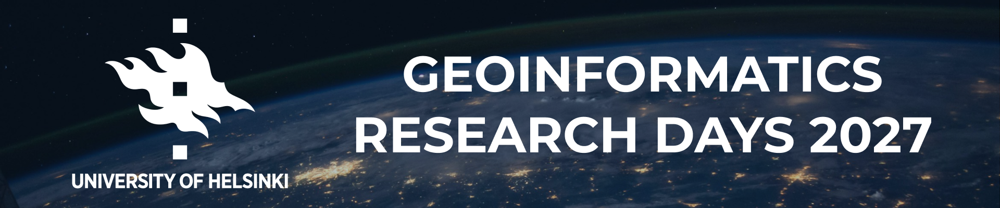
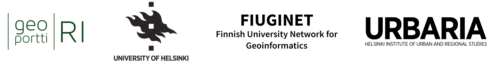

.. Title used when the site is linked (previews in Slack, Teams, social media) and in search results;
.. the heading shown on the page is "Welcome" below.
.. title:: Geoinformatics Research Days 2027

=======
Welcome
=======

The *Geoinformatics Research Days* (GRD) event is the annual gathering for geoinformatics experts, 
which has been organized by the member universities of the Finnish University Network for Geoinformatics 
(`FIUGINET <https://www.geoportti.fi/services/skills-development/fiuginet/>`_) 
for over 10 years. The event will take place on **10–12 May 2027**, and will be organized by University of Helsinki together 
with the FIUGINET network, hosted in Helsinki, Finland.

The three days bring together keynotes, parallel presentation sessions, posters, and plenty of time for networking.
The event is held in English, and while it is a national gathering, participants from outside Finland are warmly welcome too.
**Participation is free of charge.**

.. The program includes the **Final Event of the Geospatial Challenge Camp (GCC)**, where multidisciplinary 
.. teams of early-career researchers and students present solutions to real-world sustainability challenges using geospatial data and technologies. 
.. Learn more at the `Geospatial Challenge Camp website <https://challenge-camp.geoportti.fi/>`_.

Important Dates
===============

**Conference:** 10–12 May 2027

**Sessions**

- Proposals open: 28 October 2026
- Proposal deadline: 27 November 2026
- Notification of acceptance: 4 December 2026

**Abstracts**

- Submission opens: 9 December 2026
- Submission deadline: 8 February 2027
- Notification of acceptance: 8 March 2027

**Registration**

- Registration opens: 8 March 2027
- Presenter registration deadline: 2 April 2027
- Registration closes: 26 April 2027

Venue
=====

**Main Building, City Center Campus, University of Helsinki**.
See :doc:`Practical Information <pages/practical_information>` for more details.

.. The map is shared with pages/practical_information.rst; edit it in _includes/venue_map.html
.. raw:: html
   :file: _includes/venue_map.html

Registration
==============

.. Places are limited, so we encourage you to register early to secure your spot.

We warmly invite all interested in the field to participate, including researchers, industry professionals, 
public sector experts, and students. **Participation is free of charge.**

Registration will open in March 2027.

.. When registration opens on 8 March 2027: replace the line above with the lines below
.. (remove ".. " from the start of each line and keep the indentation), and add the registration link.

.. Registration is open until **26 April 2027**. Presenters, please register by **2 April 2027**.

.. .. button-link:: REGISTRATION_URL
..     :color: primary
..     :shadow:
..     :align: center

..     👉 Register here

Contact Us
===============

For questions or further information, please contact us by email:

.. admonition:: Email address
    :class: note

    **geoinfo-research-days@helsinki.fi**

News and updates are shared on `Geoportti's LinkedIn <https://www.linkedin.com/company/geoportti/>`_
and through the FIUGINET network.

Event Partners and Sponsors
===========================

.. Pages of the site: keep in sync with nav_links (top bar) in conf.py
.. toctree::
   :hidden:

   Submissions <pages/submissions>
   Program <pages/program>
   Practical Information <pages/practical_information>